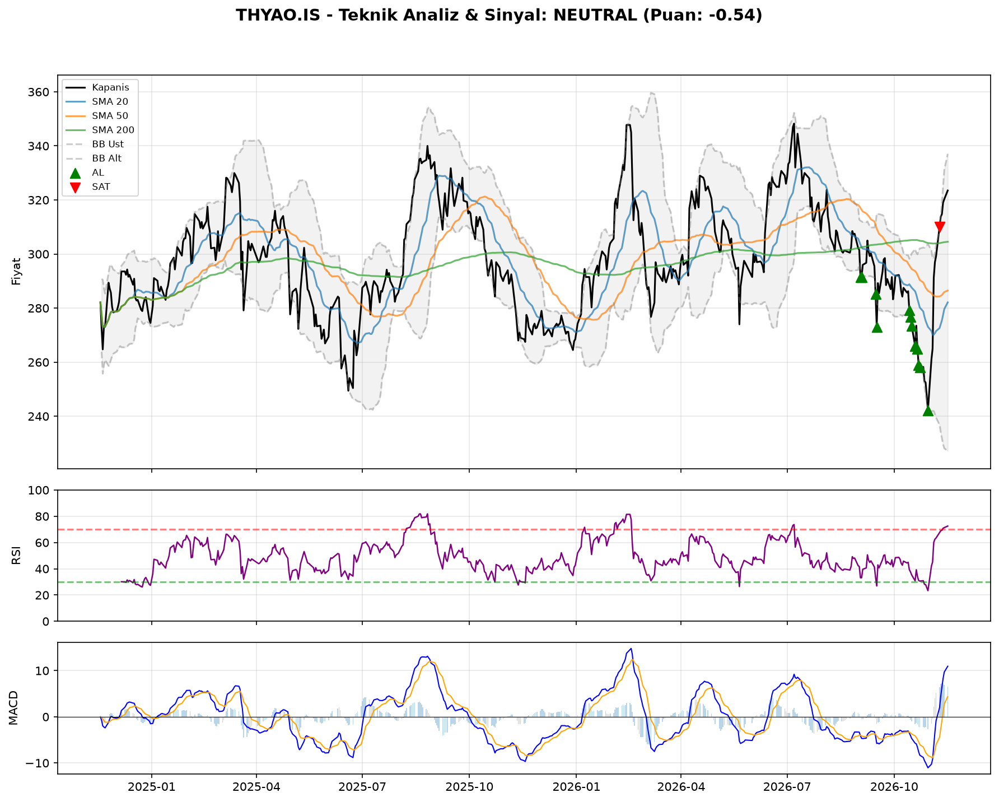
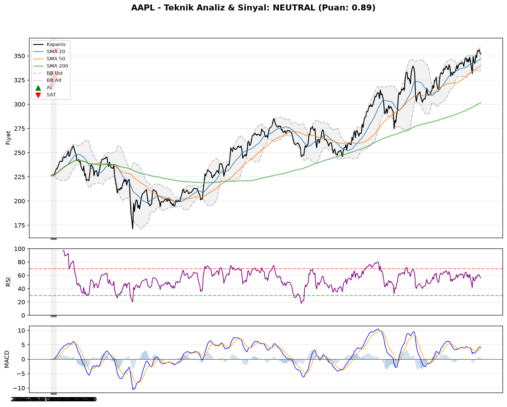
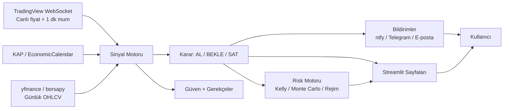

# HSC Borsa Analiz

> Borsa İstanbul (BIST) hisseleri için gerçek veriyle çalışan, açıklanabilir ve risk odaklı alım/satım karar destek paneli.

HSC Borsa Analiz; bir komut satırı sinyal botundan evrilen, tarayıcıdan kullanılan bir **Streamlit** uygulamasıdır. Canlı fiyat (WebSocket), KAP bildirimleri, teknik göstergeler, piyasa rejimi ve istatistiksel doğrulama araçlarını tek çatı altında toplar.


## Öne çıkanlar

- **Akıllı Panel:** Açılışta sade 3 adım — piyasa durumu, tek net karar (AL/BEKLE/SAT + sade gerekçe), kurgusal portföy. BIST 100 rejimine göre *hangi yöntemin kullanılacağını* önerir. 16 sayfanın tamamı her zaman açık sol menüde düz butonlar olarak görünür; açılır "daha fazla" menüsü yoktur.
- **Sade dil sözlüğü:** RSI, MACD, Monte Carlo, R çarpanı gibi 20 teknik terimin panelde tek tıkla açıklaması
- **Fail-closed veri kapısı:** Her sinyal gösterilmeden önce fiyat geçerliliği, kaynak, tazelik ve anomali kontrollerinden geçer. Doğrulanamayan veride AL/SAT **bastırılır** ve BEKLE'ye çekilir. Yan menüdeki **kill switch** ile tüm sinyaller anında kapatılabilir.
- **Karar denetim kaydı:** Her karar/yanıt, hangi veri ve doğrulama sonucuyla üretildiyse o şekilde yerel, eklemeli ve idempotent bir JSONL kayda yazılır (aynı veri iki kez kaydedilmez).
- **Birleşik hareket sistemi:** Stripe/Linear/Material 3 ilkeleriyle tek bir token katmanı (120/200/260ms, ease-out), aşamalı kart girişleri, transform/opacity tabanlı iskelet yükleyiciler, odak halkaları ve tam `prefers-reduced-motion` desteği.
- **İnsan odaklı AI asistanı:** Hisse analizinin ötesine geçer — *"Portföyümü incele"*, *"Neden bu sinyal?"*, *"Riskim ne?"*, *"Verinin kaynağı nedir?"* sorularını anlar; lehte/aleyhte kanıt ve geçersizleştirici koşullar üretir; emir/kesinlik/canlı fiyat/tahmin isteklerini reddeder; her yanıttan sonra bağlamlı takip soruları önerir. Gemini anahtarı yoksa deterministik yerel özet devreye girer.
- **Yönlendirici yardım:** Giriş ekranında ve her sayfada küçük açılır paneller ("Bilgileri nereye gireceğim?", "Nasıl kullanılır?"), 5 adımlı animasyonlu rehber penceresi ve hisse seçildiğinde görünen kısa onay animasyonu
- **Görsel güven katmanı:** İki panelli giriş ekranı; solda animasyonlu marka paneli, **animasyonlu BIST tarzı mum grafiği** (temsili), 4 istatistik kartı (804 hisse / 16 araç / 1 dk canlı mum / 0 gerçek emir), dürüst "Neden HSC?" övgü metinleri ve Material ikonlu güven rozetleri (şifre korumalı, canlı veri, rejim analizi, paper-only)
- **Anlık işlem sinyali:** 1 dakikalık canlı mumlardan 5m/15m EMA9/20, VWAP, RSI7 ve hacim patlaması tetikleyicileri; seans ve KAP acil-duyuru filtreleri
- **İşlem ajansı:** Rejime göre ağırlıklandırılmış 9 zaman dilimi uyumu, tam işlem planı (giriş / ATR stop / 1.5R-2.5R-4R hedefler / Kelly+volatilite boyutu / ufuk / geçersizleme)
- **Akıllı karar motoru:** AL / BEKLE / SAT trafik lambası, faktör katkı grafiği, gerekçeler
- **Gelecek K/Z projeksiyonu:** 1/5/20 günlük Monte Carlo bantları, stop/hedef olasılıkları, benzer sinyallerin MFE/MAE profili
- **BIST tarayıcı:** 804 kayıtlı hissenin tamamı ~0.3 sn'de taranır; çoklu seçim kalıcıdır
- **Bilimsel doğrulama:** Deflated Sharpe Ratio, PBO/CSCV, permütasyon testi, purge+embargo'lu walk-forward, Brier kalibrasyonu
- **Bildirimler:** ntfy.sh (hesapsız), Telegram ve e-posta; yalnızca karar **değiştiğinde** tek seferlik bildirim
- **Kullanıcı hesapları:** PBKDF2 hash'li şifre, kullanıcıya özel ayarlar / kurgusal portföy / sinyal geçmişi
- **Şeffaf sinyal performans defteri:** Kapanan her kurgusal sinyal giriş / stop / hedef / çıkış ve **R çarpanı**yla kaydedilir; kazananlar *ve* kaybedenler aynı tabloda, kümülatif R eğrisi, drawdown, kazanma oranı, kâr faktörü ve beklentiyle birlikte gösterilir. Komisyon / spread / kayma varsayımlarıyla **maliyet sonrası R** ayrıca hesaplanır
- **Veri kaynağı ve tazelik:** Akıllı Panel'de kotasyon kaynağı, veri yaşı ve ~15 dk gecikme uyarısı rozetlerle gösterilir; eski veri ayrıca işaretlenir
- **Risk merkezi:** Rejim tespiti, Kelly boyutu, Monte Carlo zarar olasılığı, korelasyon ve çeşitlendirme

## Ekran görüntüleri





## Sayfalar

| Sayfa | Açıklama |
|---|---|
| **Akıllı Panel** | Sade giriş ekranı: rejim yönlendirici, tek karar kartı, portföy özeti |
| Anlık sinyal | Canlı 1 dakikalık mumlardan tetikleyici tabanlı AL/SAT |
| İşlem ajansı | Tam işlem planı, ön kontroller, güven kalibrasyonu |
| Sinyal terminali | 8 hisseye kadar 15 sn'lik canlı sinyal matrisi ve değişim bildirimleri |
| BIST tarayıcı | 804 hissenin teknik filtrelerle taranması |
| İşlem botu | Sohbet tarzı analiz, çoklu hisse, AI yorumu, manuel emir taslağı |
| Canlı işlem | Anlık kotasyon, KAP haberleri, gösterge panelleri |
| Hesabım | Kurgusal portföy, 15 dk net K/Z tablosu, veri sıfırlama |
| Sinyal performansı | Şeffaf sonuç defteri, R çarpanı, kümülatif eğri, kazanma/kâr faktörü/beklenti |
| Akıllı risk merkezi | Rejim, Kelly, Monte Carlo, portföy riski |
| Strateji laboratuvarı | Walk-forward, parametre duyarlılığı, bilimsel doğrulama |
| Denetim ve doğrulama | Yapılandırma doktoru, API rehberi, gerçek para kontrol listesi |
| Piyasa analizi | İzleme listesi taraması, ekonomik takvim |
| Hisse detayı | Fiyat/EMA/SMA/Bollinger, hacim, RSI, MACD, backtest |
| Portföy ve test | Dağılım önerisi ve getiri karşılaştırması |
| Ayarlar | Semboller, eşikler, ağırlıklar, risk, bildirimler, koruma kuralları |

## Kurulum

```bash
git clone https://github.com/hakansazci01/hsc-borsa-analiz.git
cd hsc-borsa-analiz
python -m venv .venv
.venv\Scripts\activate        # Windows
pip install -r requirements.txt
streamlit run streamlit_app.py
```

### Windows - tek tıkla başlatma

1. Python 3.10+ kurulu olmalı (kurulumda **Add Python to PATH** işaretli olmalı): https://www.python.org/downloads/
2. Depoyu indirip `calistir.bat` dosyasına **çift tıklayın**

İlk çalıştırmada .bat sanal ortamı ve gerekli paketleri otomatik yükler (İnternet gerekir). İkinci çalıştırmada doğrudan açılır. Tarayıcı otomatik açılmazsa `http://localhost:8501` adresine gidin.

> Mac/Linux için elle kurulum gerekir: `python3 -m venv .venv`, `source .venv/bin/activate`, `pip install -r requirements.txt`, `streamlit run streamlit_app.py`.

İlk açılışta **Kayıt ol** sekmesinden bir kullanıcı oluşturun. Şifreler PBKDF2-HMAC-SHA256 ile tuzlanarak saklanır; düz metin tutulmaz. Harici API anahtarı **gerekmez**; canlı veri için internet bağlantısı gerekir.

### API anahtarları (opsiyonel)

```bash
copy .streamlit\secrets.toml.example .streamlit\secrets.toml
```

Ardından `.streamlit/secrets.toml` içine kendi anahtarlarınızı girin veya uygulamadaki **Ayarlar → Bildirim kanalları / API rehberi** bölümünü kullanın. **Anahtarlar hiçbir zaman depoya eklenmemelidir.** Tüm servisler opsiyoneldir; anahtar olmadan uygulama çalışır.

## Nasıl çalışır? — İlk kullanım akışı

1. **Giriş:** Uygulama açılınca **Kayıt ol** ile kullanıcı adı/şifre oluşturun. Verileriniz (ayarlar, kurgusal portföy, sinyal geçmişi) bu kullanıcıya özel saklanır.
2. **Akıllı Panel:** Açılış sayfasında önce piyasa durumunu görün; size önerilen yöntemi ve "Bugün ne yapmalı?" önerisini okuyun. Hisse seçip tek net karar kartını inceleyin. Detay isterseniz sol menüdeki diğer araç butonlarını kullanın.
3. **Hisse seçimi:** **Ayarlar → İzleme listesi** veya **BIST tarayıcı** sayfasından ilgilendiğiniz hisseleri seçin. BIST'te kayıtlı 804 hisse aranabilir.
4. **Sinyal alma — üç yol:**
   - **Anlık sinyal:** seans içinde 1 dakikalık canlı mumlardan EMA9/20 + VWAP + RSI7 + hacim tetikleyicileriyle anlık AL/SAT,
   - **İşlem ajansı:** bir hisse için tam işlem planı (giriş, stop, hedefler, boyut, ufuk, geçersizleme),
   - **İşlem botu:** hisse adı veya `THYAO, GARAN, ASELS` gibi çoklu sembollerle sohbet tarzı analiz.
5. **Kararı okuma:** Trafik lambası **yeşil = AL, sarı = BEKLE, kırmızı = SAT**. Puan, güven skoru ve "neden" gerekçeleri aynı ekrandadır.
6. **Kurgusal işlem:** AL/SAT sinyalinde **Kurgusal pozisyon aç** ile paper portföye ekleyin; **Hesabım** sayfasında stop/hedef/sinyal değişimine göre SAT önerilerini ve 15 dakikalık net K/Z tablosunu izleyin.
7. **Sonuçları görün:** Pozisyonu kapattığınızda sonuç otomatik olarak **Sinyal performansı** defterine R çarpanıyla işlenir; kazanma oranı, kümülatif R eğrisi ve drawdown burada güncellenir.
8. **Bildirim (opsiyonel):** Ayarlar'dan ntfy/Telegram/e-posta kanalını açın; **karar değiştiğinde** tek seferlik bildirim gider.

**Seans:** BIST 10:00–18:00 (hafta içi). Piyasa kapalıyken sinyaller bilgilendirmedir, kurgusal işlem düğmeleri devre dışıdır.



## Şeffaf sinyal performans defteri

Kapanan her kurgusal pozisyon otomatik olarak `users/<kullanici>/performance.jsonl` dosyasına işlenir. Kayıtta giriş, stop, hedef, çıkış, R çarpanı, yüzde K/Z, güven ve hem giriş hem çıkış gerekçesi bulunur. **Kazananlar ve kaybedenler aynı yöntemle hesaplanır**; sonradan seçilmiş veya gizlenmiş sonuç yoktur.

**R çarpanı**, kâr/zararın alınan riske (stop mesafesine) oranıdır: giriş 100 ₺, stop 95 ₺, çıkış 110 ₺ ise sonuç **+2R**'dır. Farklı fiyat ve oynaklıktaki hisseleri adil karşılaştırmak için kullanılır. Stop mesafesi yoksa ayarlardaki zarar-durdurma yüzdesi kullanılır ve hangi yöntemin uygulandığı kayıtta belirtilir.

**Sinyal performansı** sayfasında şunlar gösterilir:

- Özet KPI'lar: kapanan sinyal sayısı, kazanma oranı, net R, ortalama R, kâr faktörü, maksimum düşüş (R)
- Kümülatif R eğrisi ve zirveden düşüş (drawdown) grafiği
- Tüm kapanan sinyallerin tablosu (kayıplar dahil), CSV olarak indirilebilir
- Hisse ve yön bazında performans dökümü

> Bu defter kurgusal sinyallerin kaydıdır. Yeni kayıtlarda **komisyon, spread ve kayma varsayımları** (Ayarlar → Risk) maliyet olarak düşülür ve "Maliyetleri dahil et" anahtarıyla brüt/net arasında geçiş yapılabilir. Eski kayıtlarda maliyet alanı yoksa net = brüt kabul edilir. Swap/finansman maliyeti modellenmez; bunlar gerçek dolum garantisi değildir. Geçmiş performans gelecek sonuçların güvenilir göstergesi değildir. Yüksek kazanma oranı tek başına yeterli değildir; kâr faktörü ve beklentiyle birlikte okunmalıdır.

## Akıllı Panel ve sadeleştirilmiş menü

Açılış sayfası **Akıllı Panel**'dir. Amaç teknik karmaşıklığı kullanıcıdan gizlemek değil, önce doğru soruyu sormaktır:

1. **Piyasa durumu:** BIST 100 rejimi (yükseliş / düşüş / yatay / oynak) sade dille gösterilir ve *hangi yöntemin uygun olduğu* önerilir. Örn. oynak piyasada pozisyon küçültüp kısa vadeli tetikleyicilere yönlendirir, düşüşte yeni alım yerine risk yönetimini önerir.
2. **Tek net karar:** Seçilen hisse için AL / BEKLE / SAT, güven skoru, 2 cümlelik sade gerekçe ve giriş/stop/hedef seviyeleri tek kartta toplanır. "Bugün ne yapmalı?" önerisi izleme listesinin tamamını tarayıp tek aday çıkarır; aday yoksa açıkça **BEKLE** der.
3. **Kurgusal portföy:** Açık pozisyon, açık K/Z, kapanan sinyal ve net R birlikte görünür.

Sol menü **varsayılan olarak açık** gelir ve **16 sayfanın tamamı** gruplandırılmadan dikey butonlarla listelenir (Akıllı Panel'den Portföy ve test'e kadar); "Gelişmiş analizler" veya "N sayfa daha" gibi bir açılır grup yoktur. Pencere genişliğinden bağımsız olarak tüm sayfalar erişilebilir. **Hiçbir sayfa kaldırılmadı.** Panelin altındaki **"Teknik terimler sade dille"** bölümü 20 terimi günlük dille açıklar.

### Yönlendirici yardım ve animasyonlar

- **Küçük popup'lar:** Giriş ekranındaki *"Bilgileri nereye gireceğim?"*, Akıllı Panel'deki *"Rozet ne demek?" / "Nasıl kullanılır?" / "Nasıl hesaplanır?" / "Bu sayılar ne?"* ve Ayarlar'daki *"Nereye ne yazmalı?"* düğmeleri tıklanınca açılır, tekrar tıklanınca kapanır.
- **5 adımlı rehber:** Üstteki **Rehber** düğmesi kayıt → izleme listesi → piyasa durumu → karar kartı → sonuç defteri akışını anlatan bir pencere açar. **İleri / Geri** ile adımlar arasında gezinilir; pencere kapanmadan ilerler.
- **Animasyonlar:** Rehber kartı yumuşak geçişle belirir, rozetler ve onay mesajları kısa bir parlama efektiyle gösterilir. Hisse seçtiğinizde *"THYAO seçildi · karar kartı güncellendi"* bildirimi animasyonlu olarak çıkar. Hareket azaltma tercihi (`prefers-reduced-motion`) olan kullanıcılarda animasyonlar devre dışı kalır.

Bu yardım katmanı yalnızca arayüzdür; hiçbir ayarı veya analiz sonucunu değiştirmez.

### Görsel güven ve istatistik katmanı

Fintech arayüz ilkeleri (güven sinyalleri, okunabilir büyük rakamlar, tutarlı kart düzeni, ölçülü mikro-animasyon) temel alınmıştır:

- **Giriş ekranı:** Sol panelde animasyonlu marka alanı, **BIST tarzı mum grafiği** (30 mum, EMA çizgisi çizilerek animasyonlu; açıkça *"temsili görsel, canlı veri değildir"* etiketli), 4 istatistik kartı, **"Neden HSC Borsa Analiz?"** başlıklı sakin ve dürüst övgü metinleri ve canlı durum göstergesi; sağ panelde giriş/kayıt formu. Formun altındaki boşluk **"3 adımda başlayın"** kartları ve **6 özellik kartı**yla doldurulur; sayfanın en altında gerçek veri, istatistiksel doğrulama, risk odağı, şeffaf defter ve "gerçek emir yok" maddelerinden oluşan bir **şeffaflık şeridi** uzanır. Form tek bir net işe odaklanır, yardım tek bir popup'ta toplanır. Grafik izole bir iframe'de render edilir (Streamlit `st.html` SVG etiketini süzer).
- **Güven rozetleri:** Şifre korumalı (PBKDF2), canlı veri, rejim analizi ve paper-only rozetleri Material ikonlarla gösterilir.
- **Akıllı Panel:** Üstte nabız atan "canlı veri" göstergesi, altta güven rozetleri.
- **Animasyonlar:** kartlar aşamalı belirir, ışık topu yavaşça süzülür, canlı nokta nabız atar; `prefers-reduced-motion` tercihinde tüm animasyonlar kapanır. Tüm CSS `hv-` önekiyle sınırlıdır, analiz sonuçlarına etkisi yoktur.

## Sık sorulan sorular ve sorun giderme

| Soru | Cevap |
|---|---|
| Sağ üstteki menü İngilizce mi? | Hayır. Streamlit'in yerleşik menüsü tarayıcıda anlık olarak Türkçe'ye çevrilir: `Rerun` → **Yeniden çalıştır**, `Clear cache` → **Önbelleği temizle**, `Print` → **Yazdır**, `Record screen` → **Ekranı kaydet**. Düğmelerin işlevi değişmez. Üstteki **Menü nedir?** popup'ı her birini ayrıntılı anlatır. |
| "Yayınla / Deploy" penceresi nedir? | Streamlit'in uygulamayı kendi bulutuna (Community Cloud / Snowflake / kendi sunucunuz) yükleme teklifidir. Bu proje **yerelde çalışan paper-only** bir karar destek uygulaması olduğu için bu düğme kaldırılmıştır; yanlışlıkla açılsa bile pencere tamamen Türkçe çevrilir. |
| Uygulama açılmıyor | Python 3.10+ kurulu ve PATH'de mi? `calistir.bat` sanal ortamı/paketleri otomatik kurar; internet gerekir. |
| Tarayıcı açılmadı | `http://localhost:8501` adresine gidin. Port doluysa `streamlit run streamlit_app.py --server.port 8502`. |
| Fiyat/sinyal gelmiyor | İnternet bağlantısını ve seans durumunu kontrol edin. Ücretsiz veri ~15 dk gecikmelidir. |
| Bildirim gelmiyor | ntfy için konuya abone olunduğundan ve Ayarlar'da kanalın açık olduğundan emin olun. Bildirim yalnızca karar değiştiğinde gönderilir. |
| API anahtarı şart mı? | Hayır. Tüm servisler opsiyoneldir; anahtarsız da çalışır. |
| Gerçek emir veriliyor mu? | Hayır. Sistem yalnızca kurgusal (paper) işlem yapar, aracı kuruma bağlanmaz. |
| Veri kapısı (/ fail-closed) nedir? | Her sinyal gösterilmeden önce fiyatın pozitifliği, günlük değişim bandı, alış-satış tutarlılığı, kaynak ve veri yaşı kontrol edilir. Kritik kontrol başarısızsa AL/SAT bastırılır ve **BEKLE** gösterilir — bozuk veriyle "makul görünen" sinyal üretilmez. |
| Sinyalleri nasıl kapatırım? | Sol yan menüdeki **Sinyalleri kapat (kill switch)** anahtarını açın; tüm panellerde kararlar BEKLE'ye çekilir, veri kaybı olmaz. |
| Denetim kaydı nerede? | Akıllı Panel'in altındaki **Karar denetim kaydı** bölümü son kararları, doğrulama seviyesini ve kaynağı gösterir. Kayıtlar `users/<kullanici>/hsc_audit.jsonl` dosyasındadır. |
| Bot'a ne sorabilirim? | Hisse sembolü yanında *"Portföyümü incele"*, *"THYAO neden AL?"*, *"Risk profilime uygun muyum?"*, *"Bugün ne değişti?"*, *"BIST 100'a göre nasıl?"*, *"Verinin kaynağı nedir?"* sorularını sorabilirsiniz. Her yanıtın altında bağlamlı takip önerileri çıkar. |
| Bot bana emir veya kesin sinyal verir mi? | Hayır. Emir, kesinlik, canlı fiyat ve yarın tahmini isteyen sorular açıkça reddedilir; bot sizi onaylamak için değil riskleri göstermek için çalışır. |
| Rehberi nereden açarım? | Giriş yaptıktan sonra üstteki **Rehber** düğmesiyle 5 adımlı turu açın; İleri/Geri ile gezinin. |
| Bir düğmenin ne yaptığını bilmiyorum | Akıllı Panel'deki *"Nasıl kullanılır?"* ve Ayarlar'daki *"Nereye ne yazmalı?"* popup'larına tıklayın; her adımın yanında açıklama var. |
| Diğer analiz sayfalarına nasıl ulaşırım? | Sol menüdeki butonlara tıklayın; 16 sayfanın tamamı açılır menü olmadan, her ekran genişliğinde doğrudan görünür. |
| Teknik terimleri anlamıyorum | Akıllı Panel'in en altındaki **"Teknik terimler sade dille"** bölümüne bakın; RSI'dan Monte Carlo'ya 20 terim günlük dille açıklanır. |
| R çarpanı nedir? | Kâr/zararın alınan riske (stop mesafesine) oranı. Detaylı anlatım **Sinyal performansı** sayfasındaki "R çarpanı nasıl hesaplanıyor?" bölümünde. |
| Sonuç defteri nerede saklanıyor? | `users/<kullanici>/performance.jsonl`. Hesabı silince veya veriler sıfırlanınca kaldırılır. |
| Şifremi unuttum | Yerel hesap sistemi olduğu için e-posta ile sıfırlama yok; hatırladığınız bir şifreyle kayıt olun. |
| Verilerimi sıfırlamak | **Hesabım → Verilerimi sıfırla** ayar/portföy/geçmişi temizler; **Hesabı sil** tüm hesabı kaldırır. |

## Yapı

```
borsa_bot/     # Sinyal, gösterge, backtest, veri, koruma motoru
ui/            # Streamlit katmanı: güven kapısı, denetim kaydı, hareket sistemi, akıllı rehber, sade dil sözlüğü, ajan, terminal, intraday, risk, performans defteri, doğrulama
app_pages/     # 16 sayfa (Akıllı Panel + 15 analiz aracı)
docs/          # Denetim raporu, araç planı, görseller
assets/        # Logo
```

## Test ve doğrulama

- `python -m compileall` ile tüm modüller derlenir
- AppTest ile giriş + 16 sayfa + etkileşimler (buton, seçim, kayıt/sıfırlama, kurgusal işlem) doğrulanır
- Agent API ile çalışan uygulama üzerinden tüm sayfalar `ready` durumunda doğrulanır
- Denetim raporu: `docs/AUDIT_REPORT.md`

## ⚠️ Yasal uyarı

Bu proje **yatırım tavsiyesi vermez** ve **aracı kuruma emir göndermez**. Tüm işlemler kurgusal (paper) simülasyondur. Ücretsiz veri kaynakları **~15 dakika gecikmelidir**; gerçek zamanlı BIST verisi lisanslı veri sağlayıcı gerektirir. Geçmiş performans gelecek getiriyi garanti etmez. Denetim sayfasındaki kontrol listesi mevcut strateji için **"GERÇEK PARA İÇİN ONAYLANMADI"** sonucunu vermektedir.

## Lisans

MIT — detaylar için `LICENSE` dosyasına bakın.
