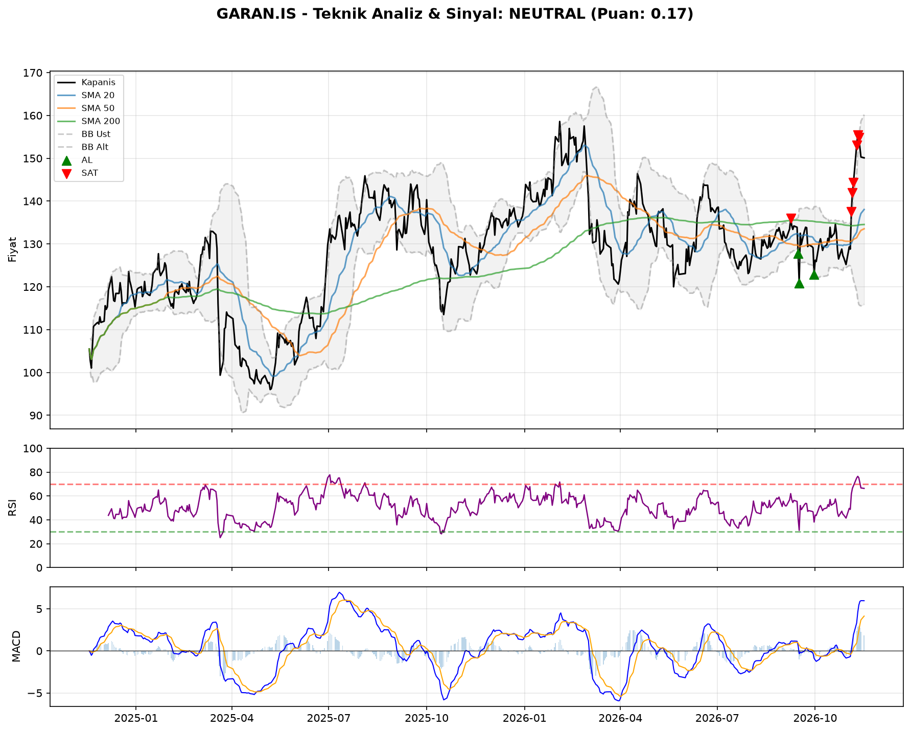

# HSC Borsa Analiz

> Borsa İstanbul (BIST) hisseleri için gerçek veriyle çalışan, açıklanabilir ve risk odaklı alım/satım karar destek paneli.

HSC Borsa Analiz; bir komut satırı sinyal botundan evrilen, tarayıcıdan kullanılan bir **Streamlit** uygulamasıdır. Canlı fiyat (WebSocket), KAP bildirimleri, teknik göstergeler, piyasa rejimi ve istatistiksel doğrulama araçlarını tek çatı altında toplar.


## Öne çıkanlar

- **Anlık işlem sinyali:** 1 dakikalık canlı mumlardan 5m/15m EMA9/20, VWAP, RSI7 ve hacim patlaması tetikleyicileri; seans ve KAP acil-duyuru filtreleri
- **İşlem ajansı:** Rejime göre ağırlıklandırılmış 9 zaman dilimi uyumu, tam işlem planı (giriş / ATR stop / 1.5R-2.5R-4R hedefler / Kelly+volatilite boyutu / ufuk / geçersizleme)
- **Akıllı karar motoru:** AL / BEKLE / SAT trafik lambası, faktör katkı grafiği, gerekçeler
- **Gelecek K/Z projeksiyonu:** 1/5/20 günlük Monte Carlo bantları, stop/hedef olasılıkları, benzer sinyallerin MFE/MAE profili
- **BIST tarayıcı:** 804 kayıtlı hissenin tamamı ~0.3 sn'de taranır; çoklu seçim kalıcıdır
- **Bilimsel doğrulama:** Deflated Sharpe Ratio, PBO/CSCV, permütasyon testi, purge+embargo'lu walk-forward, Brier kalibrasyonu
- **Bildirimler:** ntfy.sh (hesapsız), Telegram ve e-posta; yalnızca karar **değiştiğinde** tek seferlik bildirim
- **Kullanıcı hesapları:** PBKDF2 hash'li şifre, kullanıcıya özel ayarlar / kurgusal portföy / sinyal geçmişi
- **Risk merkezi:** Rejim tespiti, Kelly boyutu, Monte Carlo zarar olasılığı, korelasyon ve çeşitlendirme

## Ekran görüntüleri





## Sayfalar

| Sayfa | Açıklama |
|---|---|
| Anlık sinyal | Canlı 1d mumlardan tetikleyici tabanlı AL/SAT |
| İşlem ajansı | Tam işlem planı, ön kontroller, güven kalibrasyonu |
| Sinyal terminali | 8 hisseye kadar 15 sn'lik canlı sinyal matrisi ve değişim bildirimleri |
| BIST tarayıcı | 804 hissenin teknik filtrelerle taranması |
| İşlem botu | Sohbet tarzı analiz, çoklu hisse, AI yorumu, manuel emir taslağı |
| Canlı işlem | Anlık kotasyon, KAP haberleri, gösterge panelleri |
| Hesabım | Kurgusal portföy, 15 dk net K/Z tablosu, veri sıfırlama |
| Akıllı risk merkezi | Rejim, Kelly, Monte Carlo, portföy riski |
| Strateji laboratuvarı | Walk-forward, parametre duyarlılığı, bilimsel doğrulama |
| Denetim ve doğrulama | Yapılandırma doktoru, API rehberi, gerçek para kontrol listesi |
| Piyasa analizi | İzleme listesi taraması, ekonomik takvim |
| Hisse detayı | Fiyat/EMA/SMA/Bollinger, hacim, RSI, MACD, backtest |
| Portföy ve test | Dağılım önerisi ve getiri karşılaştırması |
| Ayarlar | Semboller, eşikler, ağırlıklar, risk, bildirimler, koruma kuralları |

## Kurulum

```bash
git clone https://github.com/hakansazci01/hsc-borsa-analiz.git
cd hsc-borsa-analiz
python -m venv .venv
.venv\Scripts\activate        # Windows
pip install -r requirements.txt
streamlit run streamlit_app.py
```

### Windows - tek tıkla başlatma

1. Python 3.10+ kurulu olmalı (kurulumda **Add Python to PATH** işaretli olmalı): https://www.python.org/downloads/
2. Depoyu indirip `calistir.bat` dosyasına **çift tıklayın**

İlk çalıştırmada.bat sanal ortamı ve gerekli paketleri otomatik yükler (internet gerekir). İkinci çalıştırmada doğrudan açılır. Tarayıcı otomatik açılmazsa `http://localhost:8501` adresine gidin.

> Mac/Linux için elle kurulum gerekir: `python3 -m venv .venv`, `source .venv/bin/activate`, `pip install -r requirements.txt`, `streamlit run streamlit_app.py`.

İlk açılışta **Kayıt ol** sekmesinden bir kullanıcı oluşturun. Şifreler PBKDF2-HMAC-SHA256 ile tuzlanarak saklanır; düz metin tutulmaz. Harici API anahtarı **gerekmez**; canlı veri için internet bağlantısı gerekir.

### API anahtarları (opsiyonel)

```bash
copy .streamlit\secrets.toml.example .streamlit\secrets.toml
```

Ardından `.streamlit/secrets.toml` içine kendi anahtarlarınızı girin veya uygulamadaki **Ayarlar → Bildirim kanalları / API rehberi** bölümünü kullanın. **Anahtarlar hiçbir zaman depoya eklenmemelidir.** Tüm servisler opsiyoneldir; anahtar olmadan uygulama çalışır.

## Yapı

```
borsa_bot/     # Sinyal, gösterge, backtest, veri, koruma motoru
ui/            # Streamlit katmanı: ajan, terminal, intraday, risk, doğrulama
app_pages/     # 14 sayfa
docs/          # Denetim raporu, araç planı, görseller
assets/        # Logo
```

## Test ve doğrulama

- `python -m compileall` ile tüm modüller derlenir
- AppTest ile giriş + 14 sayfa + etkileşimler (buton, seçim, kayıt/sıfırlama, kurgusal işlem) doğrulanır
- Agent API ile çalışan uygulama üzerinden tüm sayfalar `ready` durumunda doğrulanır
- Denetim raporu: `docs/AUDIT_REPORT.md`

## ⚠️ Yasal uyarı

Bu proje **yatırım tavsiyesi vermez** ve **aracı kuruma emir göndermez**. Tüm işlemler kurgusal (paper) simülasyondur. Ücretsiz veri kaynakları **~15 dakika gecikmelidir**; gerçek zamanlı BIST verisi lisanslı veri sağlayıcı gerektirir. Geçmiş performans gelecek getiriyi garanti etmez. Denetim sayfasındaki kontrol listesi mevcut strateji için **"GERÇEK PARA İÇİN ONAYLANMADI"** sonucunu vermektedir.

## Lisans

MIT — detaylar için `LICENSE` dosyasına bakın.
